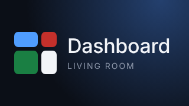

# Sony Bravia Dashboard

A custom home dashboard for a Sony Bravia (Google TV / Android TV). It installs
as an app with its own **banner tile on the TV home screen**. Open the tile and
you get a full-screen dashboard you move around with the remote's D-pad. App
tiles on the dashboard launch the real installed TV apps.



**On the home screen:** your favorite apps (pick them on the TV with
*Add favorites*), plus *All apps* and *Settings* tiles.
**Other card types available:** clock, live weather (Open-Meteo, no API key
needed), today's agenda, and notes. See `js/config.js`.

## Customise

Everything lives in [`js/config.js`](js/config.js): your name, 12/24-hour time,
°F/°C, weather location, and the list of cards. Reorder, add, or remove cards
there. Give a card `size: "wide"` or `size: "tall"` to make it bigger.

## Install it on the TV from your phone (no computer)

GitHub builds the app automatically every time this repo changes (see
[`.github/workflows/build-tv-app.yml`](.github/workflows/build-tv-app.yml)).
The newest build is always at:

```
https://github.com/Datre3/sony-braving-dashboard/releases/latest/download/bravia-dashboard.apk
```

1. **Get a short code (on your phone).** Typing that link with a remote is
   painful. Open **go.aftvnews.com** on your phone, paste the link, and note
   the short number code it gives you.
2. **Install Downloader (on the TV).** Open the Google Play Store on the TV,
   search for **Downloader** (by AFTVnews) and install it.
3. **Allow it to install apps.** Open Downloader. When it asks, allow it to
   install unknown apps. If it doesn't ask, go to *Settings → Apps → Security &
   restrictions → Unknown sources* and turn on **Downloader**.
4. **Download and install.** In Downloader, type the short code (or the full
   link) and press *Go*. When the download finishes, choose **Install**.
5. **Pin the tile.** *Dashboard* now appears under *Apps* on the home screen.
   Long-press it and add it to your favorites row.

**Updating:** edit `js/config.js` on GitHub (this works from the phone's
browser or the GitHub app). Wait about 5 minutes for the new build, then repeat
step 4 with the same code. It installs over the old version.

## Install it on the TV with a computer

The Android TV app lives in [`android/`](android/). It bundles the dashboard
(`index.html`, `css/`, `js/`) inside the APK, so nothing needs to be hosted.

**1. Build the APK**: open the `android/` folder in Android Studio and pick
*Build → Build APK(s)*, or from a terminal with the Android SDK installed:

```sh
cd android
./gradlew assembleRelease
# → app/build/outputs/apk/release/app-release.apk
```

**2. Turn on developer mode on the Bravia**: *Settings → System → About*, then
press OK on *Android TV OS build* (or *Build*) 7 times. Then under
*Settings → System → Developer options*, turn on *USB debugging* / *Network
debugging*. Note the TV's IP address (*Settings → Network & Internet*).

**3. Sideload it** from your computer on the same network:

```sh
adb connect <tv-ip-address>
adb install -r app/build/outputs/apk/release/app-release.apk
```

Accept the prompt on the TV the first time. (No computer? The *Send Files to
TV* app from Google Play plus a file manager also works.)

**4. Pin the tile**: *Dashboard* now shows up under *Apps* on the home screen.
Long-press it with the OK button and choose *Move* / *Add to favorites* to put
it in the top row.

After editing `js/config.js`, rebuild and reinstall to update the app.

### Customising the home-screen tile

- **Name:** `android/app/src/main/res/values/strings.xml` (`app_name`)
- **Banner and icon art:** edit `android/branding/banner.html` / `icon.html`,
  then run `node android/branding/render.js` (requires Playwright) to regenerate
  the PNGs. You can also drop in your own 320×180 `banner.png`.
- **Which app a tile launches:** set `package` on an `app` card in
  `js/config.js`. To find an app's package name, run
  `adb shell pm list packages`.

| App | Package |
| --- | --- |
| YouTube | `com.google.android.youtube.tv` |
| Disney+ | `com.disney.disneyplus` |
| Netflix | `com.netflix.ninja` |
| Prime Video | `com.amazon.amazonvideo.livingroom` |
| Spotify | `com.spotify.tv.android` |

If an app isn't installed, the tile opens its Play Store page instead.

## Make it the TV's home screen (replace the Google TV launcher)

The app can also act as the TV's home screen, with no Google TV
recommendations or ads. The dashboard includes an **All apps** tile that lists
everything installed, and a **Settings** tile so you can always reach the TV
settings.

Google TV doesn't let you choose a different home app in Settings, so you
switch the stock launcher off with adb (no root needed, fully reversible):

```sh
# 1. Find the stock launcher's package name
adb shell cmd package resolve-activity -a android.intent.action.MAIN -c android.intent.category.HOME

# 2. Disable it (Google TV: com.google.android.apps.tv.launcherx,
#    older Android TV: com.google.android.tvlauncher)
adb shell pm disable-user --user 0 com.google.android.apps.tv.launcherx
adb shell pm disable-user --user 0 com.google.android.tungsten.setupwraith   # Google TV only

# 3. Press Home on the remote: the dashboard is now the home screen.
```

**To undo it** (or if anything goes wrong), re-enable the stock launcher:

```sh
adb shell pm enable com.google.android.apps.tv.launcherx
adb shell pm enable com.google.android.tungsten.setupwraith
```

A factory reset also restores it. Things that live inside the Google TV
launcher (its profile switcher and *For you* recommendations) won't be
available while it's disabled. Apps, inputs, the Settings button and voice
search on the remote keep working.

**Lower-risk alternative:** Google TV has a built-in *Apps only mode* that
removes recommendations without replacing the launcher: *Settings → Accounts &
sign-in → (your account) → Apps only mode*.

## Alternative: open it in the TV browser

The dashboard also runs as a plain web page. Host the repo root with GitHub
Pages (*Settings → Pages*) and open the URL in a TV browser such as *TV Bro*.
In a browser, app tiles open their `url` instead of launching the app.

## Remote controls

| Button | Action |
| --- | --- |
| ◀ ▲ ▼ ▶ | Move between cards |
| OK | Launch the focused app tile |
| Back | Return to the TV home screen |

## Preview locally

```sh
python3 -m http.server 8080
# open http://localhost:8080
```
